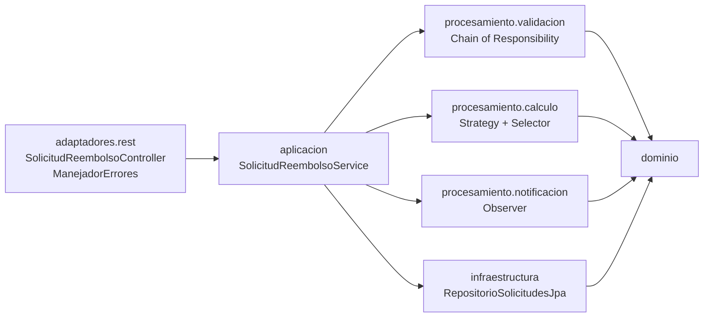

# reembolsos-integrado — Sistema de Solicitudes de Reembolso de Gastos Corporativos

Proyecto integrador de cierre (Unidad 12, Patrones de Diseño de Software). Spring Boot 3 / Java 17 / Maven. El área de Finanzas reemplaza su hoja de cálculo por un sistema que valida, calcula y notifica solicitudes de reembolso. Este README funciona como mini-documento de diseño: primero el análisis, luego la arquitectura resultante, las decisiones, el ADR y lo que se descartó.

Fecha de ejecución: 2026-11-13 · Java: 22.0.2 (Oracle JDK; el proyecto compila con `java.version` 17) · Maven: 3.9.16

## Diseño Propuesto

Análisis hecho **antes de escribir código de patrones**. Para cada requisito se identifica qué varía, qué patrón lo resuelve y por qué ese y no otro (test de explicabilidad: si no cabe en una oración, el patrón probablemente sobra).

| Requisito | Qué varía (punto de variabilidad) | Patrón | Justificación en una oración |
|---|---|---|---|
| **RF1** Validación en varias etapas | El **conjunto y el orden de verificaciones** previas a la aprobación: hoy 3, y Finanzas ya anunció una cuarta (límite anual acumulado) | **Chain of Responsibility** | Cada verificación decide por sí misma si rechaza o pasa a la siguiente sin conocer a las demás, así que agregar el límite anual es agregar un eslabón sin modificar los existentes. |
| **RF2** Cálculo distinto por categoría | La **fórmula del monto aprobado**, distinta para viáticos, representación y capacitación, y con categorías nuevas previstas (bienestar) | **Strategy** (con selección por categoría) | Son fórmulas intercambiables detrás de una misma interfaz que se elige según un dato (la categoría), así que una categoría nueva es una clase nueva y no un `case` más en un método existente. |
| **RF3** Notificación simultánea | **Quién se entera y cómo reacciona** ante un cambio de estado: empleado (todo), Contabilidad (solo aprobaciones), auditoría (todo) y pronto un panel de métricas | **Observer** | Los interesados reaccionan de forma distinta al mismo evento y su número crece, así que el servicio publica el cambio a una lista de observadores sin conocer a ninguno en concreto. |

**Por qué no otro patrón.**

- **RF1.** *Strategy* elige una sola variante; aquí se aplican todas en secuencia y la primera que falla corta el proceso. Un `if` encadenado dentro del servicio obliga a editar ese método con cada verificación nueva. Una `List<Validador>` recorrida con un `for` sería la versión mínima equivalente; se prefiere la cadena porque el corte vive en cada eslabón (no en el orquestador) y el enunciado describe *etapas* encadenadas.
- **RF2.** Un `switch` sobre la categoría obliga a modificar código ya escrito con cada categoría nueva, que es justo lo que Finanzas pide evitar. Una jerarquía por herencia (*Template Method*) no aporta: las tres fórmulas no comparten un esqueleto de pasos, solo un resultado.
- **RF3.** Llamar a cada notificador desde el servicio acopla el servicio a cada interesado y exige editarlo con cada uno nuevo. Un bus de eventos de Spring es más indirección de la necesaria para tres observadores fijos (ver «Qué se descartó y por qué»).

No se propone ningún patrón adicional: ningún requisito de la especificación lo pide.

## Arquitectura resultante



- **dominio**: `SolicitudReembolso`, `CategoriaGasto`, `EstadoSolicitud`.
- **procesamiento**: los tres patrones. No depende de infraestructura, adaptadores ni JPA (regla ArchUnit 1); los validadores y calculadoras se prueban con `new`, sin contenedor de Spring.
- **aplicacion**: `SolicitudReembolsoService` es el único punto que coordina los tres patrones y el único que conoce el repositorio.
- **infraestructura**: `RepositorioSolicitudesJpa` (Spring Data JPA, H2). Sin puerto intermedio (ADR-001).
- **adaptadores.rest**: el controlador solo habla con el servicio de aplicación (regla ArchUnit 2).

Flujo de `POST /api/solicitudes`: el servicio carga las pendientes del empleado → `CadenaValidadores` (documentos → monto → duplicados) → `SelectorCalculadora` elige la estrategia de la categoría → se guarda como `PENDIENTE`. Flujo de `PUT /api/solicitudes/{id}/estado`: se guarda el nuevo estado y se notifica a todos los `ObservadorCambioEstado` con el estado anterior.

## Decisión de diseño 1 — Orden de la cadena de validadores

**Orden elegido:** documentos soporte → monto máximo → duplicados.

**Criterio de eficiencia.** `ValidadorDuplicados` es el eslabón más caro: recorre la lista de solicitudes pendientes y compara categoría y periodo (año y mes) con cada una. `ValidadorDocumentosSoporte` lee un booleano y `ValidadorMontoMaximo` hace una comparación. Como la cadena se detiene en el primer rechazo, poner primero los eslabones baratos significa que las solicitudes sin documentos o con monto excedido (rechazos que no necesitan consultar nada más) nunca llegan a recorrer la lista. La prueba `CadenaValidadoresTest.elEslabonDeDuplicadosNoSeEjecutaSiYaFallaUnoAnterior` lo demuestra con una lista que lanza excepción si se la recorre.

**Qué se gana:** el costo del eslabón caro solo se paga cuando la solicitud ya superó las verificaciones baratas. **Qué se pierde:** con duplicados al final, una solicitud con dos problemas solo informa el primero (el empleado corrige y reintenta); con duplicados primero, el error visible sería otro. Y si duplicados fuera primero, *toda* solicitud pagaría el recorrido, incluso las que se van a rechazar por falta de documentos.

**Matiz honesto:** el ahorro real es acotado. El servicio carga las pendientes de la base de datos *antes* de invocar la cadena, de modo que esa consulta se paga siempre, sin importar el orden; lo que el orden evita es el recorrido en memoria, barato mientras un empleado tenga pocas pendientes. Un ahorro mayor exigiría cargar la lista de forma diferida (ver «Qué se descartó y por qué»).

## Decisión de diseño 2 — Mapa inyectado frente a `switch` para elegir la calculadora

**Elegido:** `SelectorCalculadora` construye un `Map<CategoriaGasto, CalculadoraReembolso>` a partir de la `List<CalculadoraReembolso>` que Spring inyecta con todos los `@Component` registrados.

**Justificación con el RF2.** Finanzas planea categorías nuevas «sin modificar el cálculo de las categorías existentes». Con el mapa, la categoría nueva es una clase `@Component` nueva: ni `SelectorCalculadora` ni las tres calculadoras existentes cambian una sola línea. Con un `switch` manual habría que editar el método selector (código ya escrito y probado) con cada categoría, y un caso olvidado compilaría y fallaría en ejecución. El mapa además da un error explícito si falta una calculadora (`Categoria no soportada: X`) y detecta categorías duplicadas al arrancar (`toMap` lanza excepción).

**Límite que conviene decir:** agregar «bienestar» tampoco es completamente gratis: exige la constante en `CategoriaGasto` (dominio) y una entrada de tope en `ValidadorMontoMaximo`. Es un punto de modificación oculto, documentado en «Qué se descartó y por qué» (centralizar los topes).

## Decisión de diseño 3 y ADR-001 — Resumen

Documento completo: [`docs/adr/ADR-001.md`](docs/adr/ADR-001.md) (estado: aceptado, 2026-11-13).

- **Decisión 3a — Persistencia:** capas simples; `SolicitudReembolsoService` depende directamente de `RepositorioSolicitudesJpa`. No hay plan de cambiar de motor de base de datos, hay un solo repositorio y un puerto sería una abstracción especulativa (YAGNI). El criterio de la Guía (6.2: sistemas que sobrevivirán 3 años o más *con cambios de infraestructura*) no se cumple hoy para la persistencia.
- **Decisión 3b — Notificación:** sin cambios. `ObservadorCambioEstado` ya es el seam: el sistema externo de Contabilidad del próximo trimestre se integra reemplazando por dentro `NotificadorContabilidad`, y el panel de métricas es un observador más. Para la notificación el criterio sí se cumple (hay un cambio de infraestructura con fecha) y ya está cubierto sin un puerto nuevo.
- **Consecuencia negativa aceptada:** la entidad lleva anotaciones `jakarta.persistence` porque el repositorio JPA trabaja directo sobre ella.

La respuesta es distinta para cada dependencia, como pedía la evaluación: persistencia no justifica Hexagonal hoy; notificación ya tiene el punto de extensión.

## Decisión de diseño 4 — Qué prohíbe la Regla 1 de ArchUnit y por qué

La Regla 1 prohíbe que `procesamiento` dependa de `infraestructura`, `adaptadores`, `org.springframework.data..` y `jakarta.persistence..`, pero **permite** `org.springframework.stereotype.Component`.

**Justificación.** `@Component` es una anotación de estereotipo: solo marca la clase para que el contenedor la registre y no introduce ninguna dependencia de comportamiento. Una clase con `@Component` sigue siendo un objeto plano que se instancia con `new` (los tests de validadores, calculadoras y notificadores lo hacen, sin contenedor). En cambio una dependencia de Spring Data o JPA ata el paquete a una tecnología de acceso a datos, impide probarlo sin base de datos o sin contenedor, e invierte la dirección de las capas (el procesamiento de negocio pasaría a conocer cómo se persiste). Prohibir *cualquier* `org.springframework` obligaría a quitar `@Component` y a registrar cada patrón en una clase de configuración: más código y más lugares que modificar al agregar un validador, calculadora u observador, y perdería el registro automático que sostiene la decisión de diseño 2. La regla debe medir el acoplamiento que de verdad duele (datos y web), no el que es solo etiqueta. Por la misma razón se acepta `org.slf4j` en `NotificadorAuditoria`: es una dependencia transversal de logging.

## Pruebas

- **33 pruebas unitarias** (una o más por validador y por calculadora, más la cadena, el selector, los tres notificadores y el servicio con Mockito) y **1 clase de integración** `@SpringBootTest` (`ReembolsosIntegracionTest`) que recorre el flujo completo por la API REST con H2: creación en las tres categorías, rechazo sin documentos, rechazo de duplicado, aprobación que dispara a los tres observadores y 404 para un id inexistente.
- **4 pruebas ArchUnit** (`ReglasArquitectura`).

Resultado de `mvn test` al cierre de la Parte 1:

```
[INFO] Tests run: 5, Failures: 0, Errors: 0, Skipped: 0, Time elapsed: 1.384 s -- in com.empresa.reembolsos.aplicacion.SolicitudReembolsoServiceTest
[INFO] Tests run: 8, Failures: 0, Errors: 0, Skipped: 0, Time elapsed: 0.025 s -- in com.empresa.reembolsos.procesamiento.calculo.CalculadorasTest
[INFO] Tests run: 3, Failures: 0, Errors: 0, Skipped: 0, Time elapsed: 0.032 s -- in com.empresa.reembolsos.procesamiento.notificacion.NotificadoresTest
[INFO] Tests run: 4, Failures: 0, Errors: 0, Skipped: 0, Time elapsed: 0.012 s -- in com.empresa.reembolsos.procesamiento.validacion.CadenaValidadoresTest
[INFO] Tests run: 2, Failures: 0, Errors: 0, Skipped: 0, Time elapsed: 0.009 s -- in com.empresa.reembolsos.procesamiento.validacion.ValidadorDocumentosSoporteTest
[INFO] Tests run: 5, Failures: 0, Errors: 0, Skipped: 0, Time elapsed: 0.011 s -- in com.empresa.reembolsos.procesamiento.validacion.ValidadorDuplicadosTest
[INFO] Tests run: 6, Failures: 0, Errors: 0, Skipped: 0, Time elapsed: 0.013 s -- in com.empresa.reembolsos.procesamiento.validacion.ValidadorMontoMaximoTest
[INFO] Tests run: 6, Failures: 0, Errors: 0, Skipped: 0, Time elapsed: 6.726 s -- in com.empresa.reembolsos.ReembolsosIntegracionTest
[INFO] Tests run: 39, Failures: 0, Errors: 0, Skipped: 0
[INFO] BUILD SUCCESS
```

## Reglas de arquitectura (ArchUnit)

`ReglasArquitectura` verifica los límites que sí existen (ninguna regla asume puertos de persistencia, coherente con ADR-001): `procesamientoNoDependeDePersistenciaNiDeLaCapaWeb`, `controladorRestSoloUsaServicioDeAplicacionYDominio`, `calculadorasImplementanLaInterfazDeEstrategia`, `notificadoresImplementanLaInterfazDeObservador`.

```
$ mvn test -Dtest=ReglasArquitectura
[INFO] -------------------------------------------------------
[INFO]  T E S T S
[INFO] -------------------------------------------------------
[INFO] Running com.empresa.reembolsos.ReglasArquitectura
[INFO] Tests run: 4, Failures: 0, Errors: 0, Skipped: 0, Time elapsed: 2.288 s -- in com.empresa.reembolsos.ReglasArquitectura
[INFO] 
[INFO] Results:
[INFO] 
[INFO] Tests run: 4, Failures: 0, Errors: 0, Skipped: 0
[INFO] 
[INFO] ------------------------------------------------------------------------
[INFO] BUILD SUCCESS
[INFO] ------------------------------------------------------------------------
[INFO] Total time:  9.609 s
[INFO] Finished at: 2026-11-13T03:24:11-05:00
[INFO] ------------------------------------------------------------------------

Reglas ejecutadas (target/surefire-reports/TEST-com.empresa.reembolsos.ReglasArquitectura.xml):
  [OK] procesamientoNoDependeDePersistenciaNiDeLaCapaWeb
  [OK] controladorRestSoloUsaServicioDeAplicacionYDominio
  [OK] calculadorasImplementanLaInterfazDeEstrategia
  [OK] notificadoresImplementanLaInterfazDeObservador
```

El workflow `.github/workflows/arquitectura.yml` ejecuta primero las reglas y luego la suite completa en cada push y pull request a `main`.

## Qué se descartó y por qué

Criterio: ¿la variabilidad que justificaría la alternativa es real y documentada hoy, o es especulación sobre un futuro que aún no llegó? (Guía 4.2: YAGNI, Rule of Three; Guía 1.2: test de explicabilidad). Cada descarte es una decisión **vigente hoy**, no definitiva: se indica la señal que haría reconsiderarla.

### 1. `ApplicationEventPublisher` en vez de la lista de observadores inyectada
- **Qué se consideró:** publicar un evento de dominio con `ApplicationEventPublisher` y `@EventListener`, en lugar de inyectar `List<ObservadorCambioEstado>` en el servicio.
- **Por qué se descartó:** con exactamente tres observadores fijos y conocidos en compilación, el bus genérico no aporta desacoplamiento real (ya lo da la interfaz `ObservadorCambioEstado`) y sí dificulta rastrear quién reacciona a qué cambio, el costo de depuración que advierte la propia Guía sobre Observer con eventos. Pasa el test de explicabilidad al revés: no hay una oración que justifique el bus.
- **Señal para reconsiderar:** que los observadores deban ejecutarse de forma asíncrona o después del commit de la transacción, o que aparezcan observadores en otros módulos o servicios.

### 2. Visitor o Abstract Factory para exportar reportes en varios formatos
- **Qué se consideró:** anticipar que Contabilidad pediría exportar el historial en PDF y Excel además de CSV y construir una jerarquía de exportadores desde ahora.
- **Por qué se descartó:** hoy solo existe el requisito de CSV; no hay una segunda solicitud real de otro formato, así que no se cumple la Rule of Three (Guía 4.2). Sería resolver un problema que todavía no existe.
- **Señal para reconsiderar:** una segunda solicitud real de formato (la tercera confirmaría el patrón).

### 3. Patrón State para `EstadoSolicitud` (propio)
- **Qué se consideró:** modelar cada estado (PENDIENTE, APROBADA, RECHAZADA, REQUIERE_CORRECCION) como una clase con sus transiciones permitidas, porque `cambiarEstado` hoy acepta cualquier cambio (incluso APROBADA → PENDIENTE).
- **Por qué se descartó:** la especificación no define reglas de transición ni comportamiento propio por estado; el estado es solo un dato que viaja a los observadores. Crear cuatro clases para un enum sin comportamiento viola YAGNI y no pasa el test de explicabilidad: no se puede decir qué *varía* por estado. Hoy lo suficiente es el `enum`.
- **Señal para reconsiderar:** que Finanzas defina un flujo con transiciones válidas o acciones distintas por estado (p. ej. «una solicitud APROBADA ya no se puede rechazar», «REQUIERE_CORRECCION reabre el plazo»). Con dos o tres reglas de transición reales, State o una tabla de transiciones se justifica.

### 4. Carga diferida de las pendientes con `Supplier` (propio)
- **Qué se consideró:** al analizar el orden de la cadena (decisión 1) se vio que el servicio consulta las pendientes a la base de datos *aunque* la solicitud se rechace antes de llegar a `ValidadorDuplicados`. Se evaluó pasar un `Supplier<List<SolicitudReembolso>>` para que la consulta ocurra solo si el eslabón se ejecuta.
- **Por qué se descartó:** cambiaría el contrato de todos los validadores (`validarPropio` recibiría un proveedor aunque dos de tres no lo usen) para ahorrar una consulta por empleado y estado, de bajo costo. No hay una medida real de latencia que muestre el problema; optimizar sin medición es especulación (YAGNI).
- **Señal para reconsiderar:** una medición que muestre esa consulta como cuello de botella, o un cuarto validador caro que también necesite datos externos (Rule of Three sobre «validador que necesita datos costosos»).

### 5. Topes de categoría centralizados y configurables (propio)
- **Qué se consideró:** hoy el tope aparece en dos lugares (`ValidadorMontoMaximo` y la calculadora de cada categoría) y las constantes están en el código. Se evaluó exponer el tope desde `CalculadoraReembolso` o moverlo a `@ConfigurationProperties`.
- **Por qué se descartó:** son tres categorías con topes estables que Finanzas no ha pedido cambiar sin despliegue; centralizar ahora acoplaría `validacion` con `calculo` o añadiría una capa de configuración sin un cambio real que la exija. La duplicación de constantes es una deuda conocida y pequeña.
- **Señal para reconsiderar:** agregar la cuarta categoría («bienestar»), que ya exigiría tocar el validador además de crear su calculadora, o un pedido de Finanzas de cambiar topes sin redesplegar.

## Cómo ejecutar

```bash
mvn clean verify                       # compila y corre todas las pruebas
mvn test -Dtest=ReglasArquitectura     # solo las 4 reglas de arquitectura
mvn spring-boot:run                    # API en http://localhost:8080
```

Ejemplo (PowerShell):

```powershell
$body = '{"empleadoId":"E-1","categoria":"VIAJE","montoSolicitado":300000,"fechaGasto":"2026-03-10","diasViaje":3,"documentosSoporte":true}'
Invoke-RestMethod -Method Post -Uri http://localhost:8080/api/solicitudes -ContentType 'application/json' -Body $body
Invoke-RestMethod -Method Put -Uri http://localhost:8080/api/solicitudes/1/estado -ContentType 'application/json' -Body '"APROBADA"'
```
